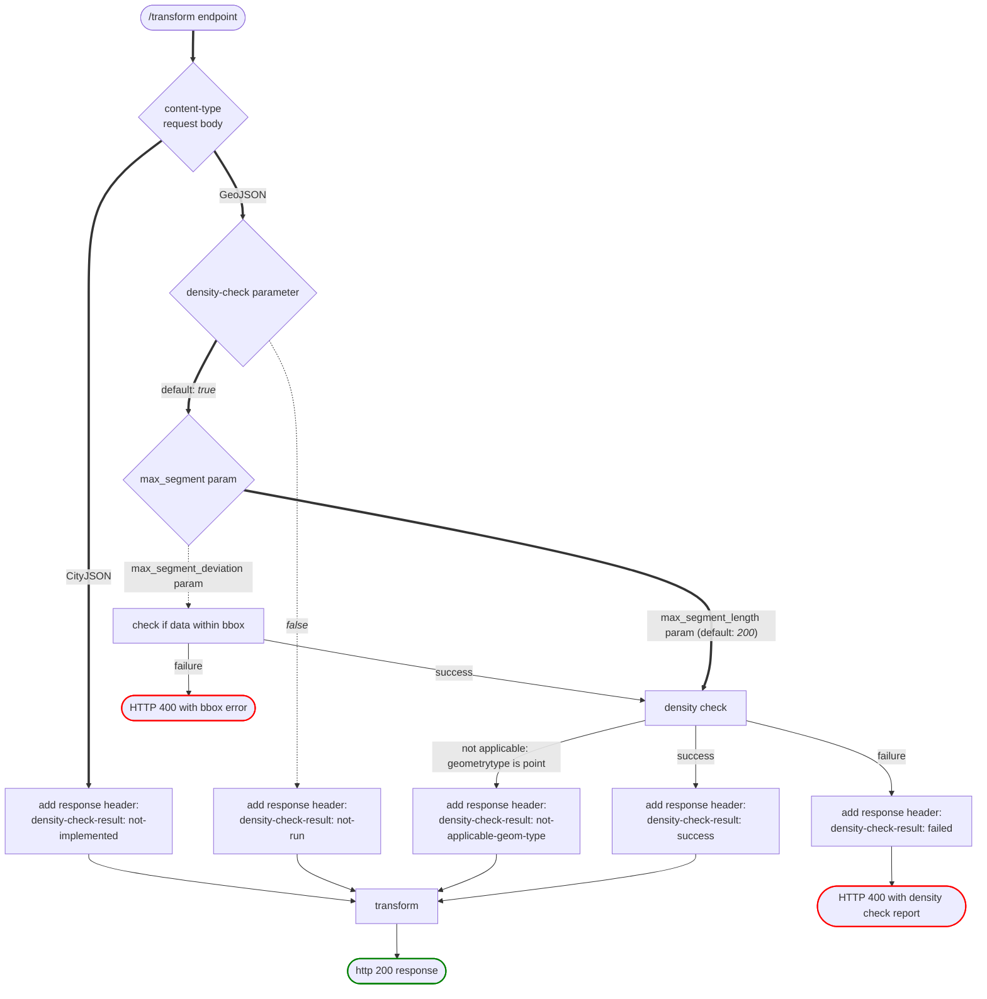

# Coordinate Transformation API

RESTful Coordinate Transformation API offering NSGI defined and NSGI recommended transformations for the Netherlands.
Build on top of pyproj and FastAPI.

## Assumptions

- API metadata, documentation and source code is in English
- API provides easy accesible and correct coordinate transformations
- Conforms (as much is possible) to the [OGC API Common](https://ogcapi.ogc.org/common/) and the
  [NL API Design rules](https://gitdocumentatie.logius.nl/publicatie/api/adr/)

## pyproj

> :warning: pyproj makes use of its own proj binaries and `PROJ_DIR`. These are set when pyproj is built.

The coordinate transformation API uses a **custom pyproj release** that includes:

- NSGI-specific CRS definitions (e.g., `NSGI:Bonaire_DPnet`, `NSGI:Saba_DPnet`)
- Updated `proj.db` database with all required transformations
- RDNAPTRANS(TM)2018 transformation grids:
  - `nl_nsgi_nlgeo2018.tif`
  - `nl_nsgi_rdcorr2018.tif`
  - `nl_nsgi_rdtrans2018.tif`
- Optional time-dependent `proj.db` database
- Additional grids for Caribbean island transformations (e.g., `bq_nsgi_bongeo2004.tif`)

**All required transformation data is already packaged with the pyproj release** installed from the custom URL in
`pyproject.toml`. No additional manual installation of transformation grids is needed.

The application is configured to automatically use the https://github.com/GeodetischeInfrastructuur/transformations
time-dependent `proj.db` (and additional assets).

## Development

Project uses [uv](https://docs.astral.sh/uv/) for package management. To get started install `uv` and run:

Install dev dependencies with:

```sh
uv sync --group dev
```

Enable [prek](https://prek.j178.dev/) pre-commit hooks with:

```sh
prek install && prek install-hooks
```

These hooks are configured in [prek.toml](prek.toml) and can be manually run with:

```sh
prek run -a
```

### direnv config

Repository also contains a [`.envrc`](https://direnv.net/) config file, which automatically activates the `uv` managed
virtual environment. See the [direnv wiki](https://github.com/direnv/direnv/wiki/Python#uv) for how to set this up.

### Tests and Coverage

Run all tests or run all tests except the validation tests:

```sh
pytest tests # all tests
pytest tests -k 'not validation' tests # all tests except validation
pytest tests -k 'validation' tests # only validation tests
```

Check test coverage (install `coverage` with `pip install coverage`):

```sh
coverage run --source=src/coordinate_transformation_api -m pytest -v tests && coverage report -m
```

Validate OAS document:

```sh
# install spectral with: npm install -g @stoplight/spectral-cli - then validate openapi doc with:
echo 'extends: "spectral:oas"\n'> /tmp/ruleset.yaml
spectral lint http://127.0.0.1:8000/openapi.json --ruleset /tmp/ruleset.yaml 
rm /tmp/ruleset.yaml
```

### pyproj Installation

The application uses a custom pyproj release that bundles all required transformation data. The release is specified in
`pyproject.toml`:

```toml
pyproj @ https://github.com/GeodetischeInfrastructuur/transformations/releases/download/2.2.0-proj9.7.1/pyproj-3.7.2+nsgi2.2.0-cp315-cp315-manylinux_2_28_x86_64.whl
```

When you install dependencies with `uv sync` (or `pip install`), this custom pyproj release is automatically downloaded
and installed with all its bundled transformation data:

- Updated `proj.db` with NSGI CRS definitions
- Time-dependent transformation database for epoch-aware transformations
- All required RDNAPTRANS(TM)2018 and Caribbean transformation grids
- Geoid data for altitude transformations

**No manual installation of transformation grids is required.** The `PROJ_DATA` environment variable is automatically
configured by the application startup to use the bundled data (see
[main.py](src/coordinate_transformation_api/main.py#L97)).

### Update Swagger UI JS/CSS dep

```sh
cd src/coordinate_transformation_api/assets/static
mkdir -p swagger-ui
cd swagger-ui
curl -L https://cdn.jsdelivr.net/npm/swagger-ui-dist@5/swagger-ui-bundle.js -o swagger-ui-bundle.js
curl -L https://cdn.jsdelivr.net/npm/swagger-ui-dist@5/swagger-ui.css -o swagger-ui.css
curl -L https://cdn.jsdelivr.net/npm/swagger-ui-dist@5/swagger-ui-standalone-preset.js -o swagger-ui-standalone-preset.js
```

## Docker

### Build container

```bash
docker build -t nsgi/coordinate-transformation-api .
```

### Run container

```bash
docker run --rm -d -p 8000:8000 --name ct-api nsgi/coordinate-transformation-api
```

## CityJSON

### Generate CityJSON models

```sh
wget --no-parent  --recursive https://3d.bk.tudelft.nl/schemas/cityjson/1.1.3/
pip install datamodel-code-generator
datamodel-codegen  --input  3d.bk.tudelft.nl/schemas/cityjson/1.1.3/metadata.schema.json  --input-file-type jsonschema --output cityjson.py
```

### Working with CityJSON (with cjio cli)

Download test/sample data from [www.cityjson.org/datasets/](https://www.cityjson.org/datasets/).

Creating a subset of CityJSON file (for - for example - testing purposes):

```sh
cjio DenHaag_01.city.json subset --random 10 save test_10.city.json
```

CRS transformation with `cjio`:

```sh
cjio test_1.city.json crs_reproject 4937 save test_1_4937.city.json
```


